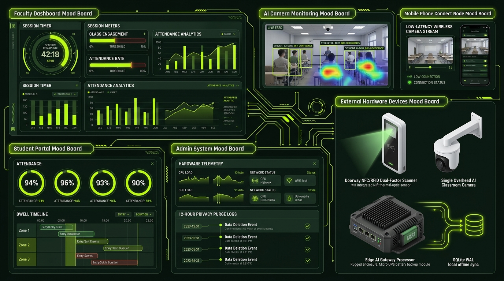
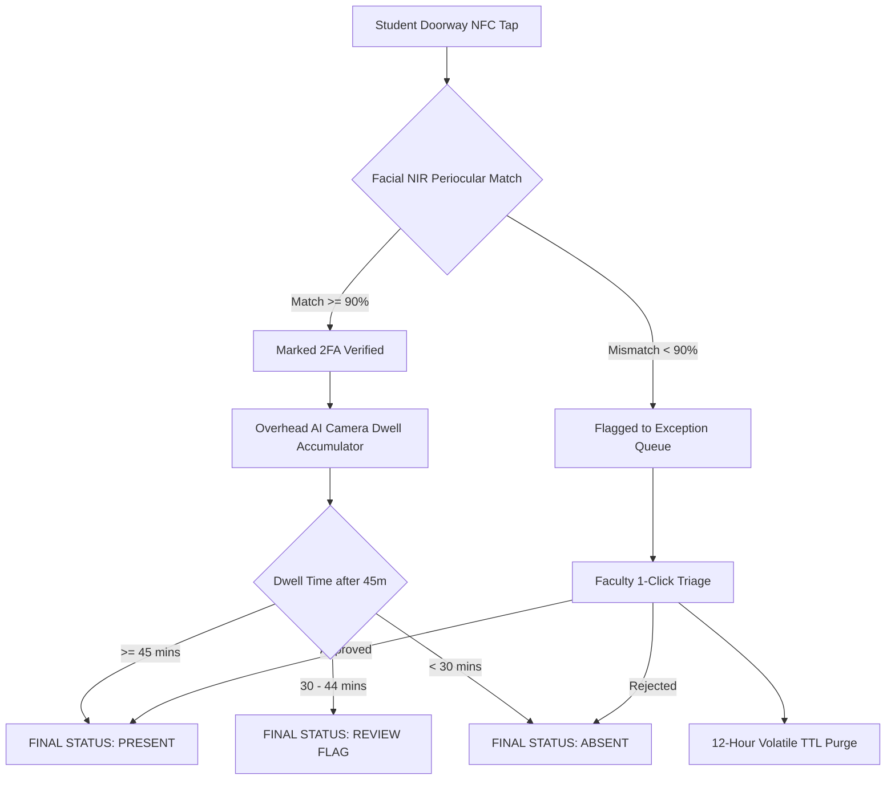

# 🚀 NIR-OmniVerify AI 2.0: AI-Driven Multi-Factor Ephemeral Attendance System

[](https://react.dev/)
[](https://vitejs.dev/)
[](https://tailwindcss.com/)
[](https://nodejs.org/)
[](https://www.sqlite.org/)
[](https://gdpr.eu/)

> **A cutting-edge, touchless multi-factor attendance verification ecosystem powered by a Single Overhead AI Camera, Doorway Near-Infrared (NIR) 2FA, 12-Hour Ephemeral Zero-Retention Privacy, and an Offline-First SQLite WAL Architecture.**

---

## 🌟 Master System Architecture & Highlights

NIR-OmniVerify AI replaces outdated, proxy-vulnerable biometric fingerprint sensors and manual roll calls with an intelligent, continuous surveillance and multi-factor validation platform.



### Key Architectural Pillars:
1. **Single Overhead AI Vision Array**: 
   - A single ceiling-mounted 4K UHD 120° FOV Near-Infrared camera monitors the entire classroom.
   - Accumulates minute-by-minute spatial student dwell time and maps real-time engagement heatmaps.
2. **Doorway Dual-Factor 2FA Verification**:
   - High-speed 13.56 MHz ISO/IEC 14443A NFC badge scanner coupled with instant 850nm NIR periocular verification.
   - Eliminates buddy-punching and fraudulent proxy check-ins in under 300ms.
3. **12-Hour Ephemeral Zero-Retention Protocol**:
   - Zero persistent storage of raw camera footage or facial biometric vector embeddings.
   - In-memory volatile RAM processing auto-shreds all temporary exception frames upon instructor review or within a 12-hour cryptographic TTL countdown.
4. **Offline-First Resilience & Micro-UPS Backup**:
   - Edge gateway powered by SQLite Write-Ahead Logging (WAL) mode.
   - Integrated Micro-UPS failover switches in `<4ms`, sustaining autonomous tracking for up to 4.8 hours during campus network or power outages with automatic cloud catch-up sync.
5. **Unified Cyber Aesthetic & Theme Engine**:
   - 5 selectable, responsive color palettes:
     - ⚡ **Electric Lime** (`#BCFF00` • Master Design System)
     - ❄️ **Quantum Cyan** (`#00F0FF` • High-Tech Arctic HUD)
     - 🌿 **Matrix Emerald** (`#10B981` • Bio-Cyber Edge)
     - ☀️ **Solar Amber** (`#F59E0B` • Industrial Telemetry)
     - 🔮 **Cyber Violet** (`#A855F7` • Holographic Mesh)
   - Every interface synchronizes dynamically to the **exact same theme color**, glowing icon badges, reticles, and atmospheric background grid.

---

## 🖥️ Dedicated User Interfaces

| Interface | Target Role | Key Capabilities |
| :--- | :--- | :--- |
| **Faculty Dashboard** | Course Instructors & Professors | Real-time 45-minute lecture progression dial, live student attendance grid, 1-click proxy buddy-punch triage, and Continuous Evaluation (CE) rubric gradebook. |
| **Student Attendance Portal** | Enrolled Students | Attendance percentage rings with $\ge 75\%$ baseline standing, digital NFC/QR student pass, minute-by-minute dwell log, and 1-click dispute appeal system. |
| **Admin Telemetry & Audit Hub** | IT Admins & Campus Security | Edge SBC CPU/RAM/Thermal loads, Micro-UPS failover simulator, SQLite offline buffer monitor, and cryptographic 12-hour zero-retention audit trails. |
| **AI Camera & Video Hub** | Vision Engine & Operators | 30 FPS Near-Infrared camera stream, proposal video playback, live webcam support, glowing multi-face bounding reticles, and spatial engagement density analytics. |
| **Mobile Phone Connect Node** | Pop-Up / Exam Classrooms | QR-code phone pairing, low-latency wireless WebRTC camera stream node, and simulated smartphone NFC wallet check-in. |
| **Master Mood Board & Specs** | Portfolio & System Review | High-definition master infographic viewer, color token breakdowns, hardware module specifications, and 1-click PDF export. |

---

## 🎨 Unified Theme & Iconography Engine

All interfaces share the **exact same color scheme** controlled by a real-time system switcher:
- **Glowing Glassmorphism Badges (`IconBadge`)**: Every Lucide icon is wrapped in a theme-reactive glass pill with matching border, glow, and micro-hover interactions.
- **Dynamic Ambient Atmosphere**: Cybernetic SVG grid background with soft animated glow orbs that shift smoothly with the active theme.
- **Standardized Status Indicators**: Consistent visual coding across all cards (Present $\ge 45\text{m}$, Review Flag $30\text{--}44\text{m}$, Absent $< 30\text{m}$).

---

## 🛠️ Tech Stack & Dependencies

### Frontend (`/client`)
- **Framework**: React 18 with Vite
- **Styling**: TailwindCSS 3.4 & Custom CSS Variables (Glassmorphism, Scanlines, Cyber Reticles)
- **Icons**: Lucide React (`IconBadge` design pattern)
- **QR Codes**: `qrcode.react`
- **State & Theme**: React Context API (`ThemeContext`) with local storage persistence
- **Audio / Video**: Native HTML5 Canvas + Video Stream HUD

### Backend & Edge (`/server`)
- **Runtime**: Node.js (ES Modules)
- **Server**: Native zero-dependency HTTP & Server-Sent Events (SSE) server
- **Database**: Local SQLite 3 in Write-Ahead Logging (WAL) Mode
- **Security**: 12-Hour TTL Cryptographic Hash Shredder Daemon

---

## 🚀 Quick Start Guide

### Prerequisites
- Node.js (v18.0.0 or later)
- Git

### 1. Clone & Setup
```bash
git clone https://github.com/killeryt668-ops/AI_ATTENDANCE_MARKER.git
cd AI_ATTENDANCE_MARKER
```

### 2. Run Backend Server (Edge AI Node)
```bash
cd server
npm install
npm start
```
*Server starts on `http://localhost:5000` with native SSE and SQLite WAL persistence.*

### 3. Run Frontend Web App (Client)
Open a new terminal window:
```bash
cd client
npm install
npm run dev
```
*Frontend opens at `http://localhost:5173`.*

### 4. Build for Production Bundle
```bash
cd client
npm run build
```
*Production assets are compiled to `client/dist`.*

---

## 📊 45-Minute Continuous Attendance Rubric



---

## 📄 License & Attribution

Designed and developed for academic innovation and edge computer vision portfolios.
- **Author**: `killeryt668-ops`
- **Architecture**: Single Camera AI Vision + 12h Zero-Retention Privacy Protocol
